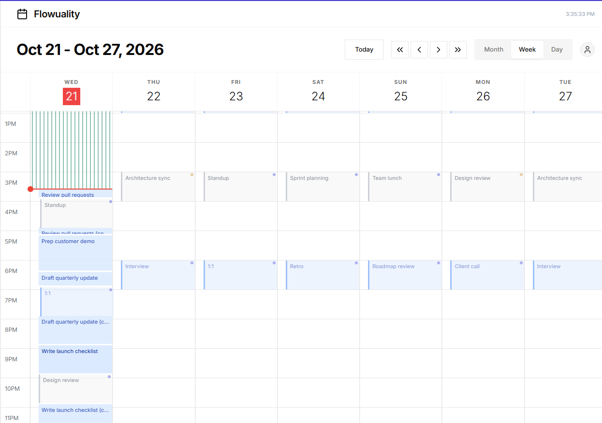

# Flowuality

**Your to-do list, flowed into the time you actually have.**

Flowuality schedules your tasks around your calendar, and around everyone else's.

**Try it:** [flowuality.com/demo](https://flowuality.com/demo). No account
needed. You get a throwaway sandbox with sample data that expires after 2 hours.

Built by Chris Kelley ([github.com/2007cjkelley](https://github.com/2007cjkelley))

## What it does

**Tasks that schedule themselves**
- Put tasks in a queue with a duration, and they're placed into the open time
  around your events. When your day changes, they move with it.
- Drag the queue to reorder it, on desktop or by press-and-hold on a phone.
- Priorities from 1 (Critical) to 4 (Low) keep important work first.
- Deadlines: a task that can't fit before its deadline is flagged. Before a
  change pushes other tasks past their deadlines, you're warned and can cancel.
- A live countdown shows the time left on the task you're on.
- Repeating tasks (daily, weekly or monthly) add a fresh copy to the queue on
  each due day.

**Events and calendars**
- Month, week and day views, a week you can slide a day at a time, and a line
  marking the current time.
- Repeating events: every N days, weeks, months or years; chosen weekdays; "the
  second Tuesday" or "the last Friday"; ending on a date, after a number of
  times, or never. Edit one occurrence, the whole series, or this and following.
- All-day and multi-day events.
- Per-event timezones: pin an event to a fixed moment (a call with someone in
  London) or keep its local clock time (a 7am workout stays at 7am when you
  travel). The app's timezone follows your device.
- Several calendars, each with its own color.
- Share a calendar with other users, with edit or view access, and full details
  or busy time only. Share a subscribable calendar link by email.
- Import and export `.ics` files (Google Calendar, Outlook, Apple Calendar).

**Notifications and mobile**
- Push and desktop notifications for events and tasks starting and ending,
  reminders 5 minutes before events, and a warning when a deadline is at risk.
  Turn event reminders on or off per calendar.
- A phone layout with Calendar, Flex Queue and Config tabs, installable as an
  app.

**Accounts:** sign up, sign in, change your password, delete your account.

## About this repo

This is the app's frontend as of October 21, 2026. The scheduling engine, the
backend and the tests are private, and some features shown in the demo were
removed from this copy. It needs the private backend to run, so the
[demo](https://flowuality.com/demo) is the way to see it work.

## Stack

- **Frontend:** React 19, Create React App with CRACO, Tailwind CSS, shadcn/ui
  (Radix), date-fns
- **Backend:** Python, FastAPI, PostgreSQL
- **Auth:** Supabase Auth
- **Hosting:** Cloudflare Workers (frontend), Railway (backend and database)
- **Notifications:** Web Push
- **Testing:** Playwright and pytest, with the full suite run on a staging
  environment before every production deploy; Jest for frontend units

## License

All rights reserved. See [LICENSE](LICENSE).
